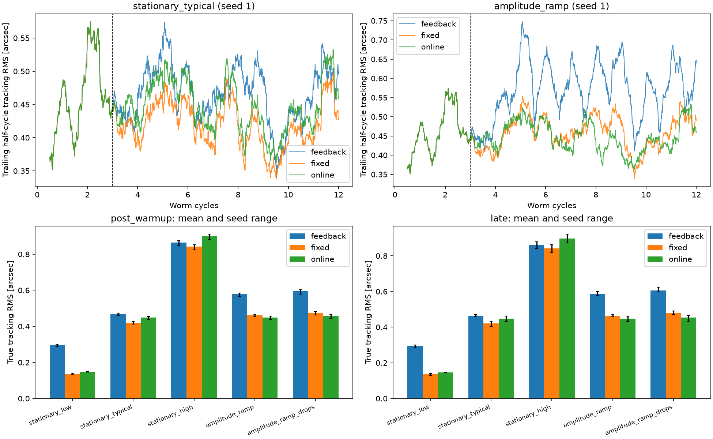

# AstroSense Guiding

PHD2のガイドログから赤道儀の周期誤差（PE）、Decバックラッシュ、
振動・突発外乱を解析するPythonツールです。日本語の診断レポート、JSON、
6面の診断画像を生成し、予測補正をオフラインで評価できます。

**開発段階：合成データで検証した研究用プロトタイプ。**
実機の有効なガイドログによる精度検証は今後の課題です。
補正指令は計算・シミュレーションまで実装しており、赤道儀へ送信する機能はありません。

## インストール

Python 3.12以上が必要です。NumPy、SciPy、Matplotlibを使用します。

```sh
git clone https://github.com/Aoi-Morio/astrosense-guiding.git
cd astrosense-guiding
python -m venv .venv
```

Windows PowerShell:

```powershell
.venv\Scripts\Activate.ps1
python -m pip install -e ".[dev]"
```

macOS / Linux:

```sh
source .venv/bin/activate
python -m pip install -e '.[dev]'
```

## 使い方

添付サンプルは実機ログではなく、真値が既知の合成データです。

```sh
# サンプルの解析。reports/にテキスト・JSON・PNGを保存
astrosense analyze samples/synth_heq5.txt --out reports

# ログファイルまたはフォルダ内のセッション一覧
astrosense scan samples/synth_heq5.txt

# 真値付きの合成PHD2ログを生成
astrosense synth samples/my_synthetic.txt --duration 3600 --backlash 800 --dither 600 --seed 1

# オンライン予測学習と固定PECの比較
astrosense benchmark --out reports/online --seeds 1 2 3 4 5

# 回帰テスト
python -m pytest -q
```

`scan`でフォルダを指定した場合は `PHD2_GuideLog*.txt` を検索します。
添付サンプルを明示的にスキャンする場合は
`astrosense scan samples/synth_heq5.txt` を使用してください。

`analyze`は既定で有効フレーム数が最も多いセッションを選びます。
`--session all`で全対象、`--session 0`で番号指定、
`--worm-period 638.3`でウォーム周期（秒）を指定できます。
画像が不要なら `--no-plot` を使用します。
`synth`の出力先の親フォルダは事前に作成してください。

## 解析と検証

| 機能 | 手法 |
|---|---|
| ログ読込 | PHD2 Log version 2.5形式、列名別名、Calibration / Guiding / INFO |
| 開ループ再構成 | 閉ループ誤差から校正レートとパルス履歴による補正効果を除去 |
| 周期誤差 | 浮動平均付き正弦波最小二乗スペクトル、多重調和モデル、セグメント別オフセット |
| Decバックラッシュ | Play operatorと局所的に細分化したプロファイル最小二乗 |
| 振動・外乱 | 残差スペクトル、ノイズ床、局所イベント、閉ループ過補正の指標 |
| 固定PEC | 調和モデルによる未来ドリフト差分予測とオフラインリプレイ |
| オンラインPEC | 固定周期の調和係数・ドリフトを逐次最小二乗（RLS）で更新 |

添付のHEQ5合成ログでは以下を再現しています。

| 指標 | 真値 | 推定値 |
|---|---:|---:|
| ウォーム周期 | 約638.3秒 | 約638.3秒（マウント名からの事前値） |
| PE P-P（天球上） | 18.80秒角 | 18.82秒角 |
| Decバックラッシュ | 800 ms | 802 ms（プロファイル1σ: 798–808 ms） |

既存PECリプレイの観測誤差RMSは0.83→0.80秒角でした。
この結果は合成データに対するもので、実機での精度や区間推定の被覆率を保証するものではありません。
生成した外乱3回に対して現在の検出結果は2件で、対応関係は調査中です。

## オンライン学習の比較

初期学習3周期・全12周期、忘却係数0.995、4高調波を固定し、
5条件×5乱数seedで、フィードバックのみ／固定PEC併用／RLS併用を比較しました。
制御器にはその時点までの観測と自身のパルス履歴だけを渡します。
未来のデータを変更しても過去の指令が変わらないことをテストしています。

学習待機後の全区間での、真の追尾誤差RMSのseed間平均（秒角）:

| 条件 | フィードバック | 固定PEC | RLS |
|---|---:|---:|---:|
| 定常PE、seeing 0.2秒角 | 0.2966 | **0.1373** | 0.1480 |
| 定常PE、seeing 0.6秒角 | 0.4677 | **0.4209** | 0.4491 |
| 定常PE、seeing 1.2秒角 | 0.8640 | **0.8420** | 0.8992 |
| PE振幅が2倍へ変化、seeing 0.6秒角 | 0.5780 | 0.4609 | **0.4497** |
| 振幅変化＋5%ランダム欠測 | 0.5959 | 0.4738 | **0.4563** |

振幅変化条件ではRLSが固定PECより平均2.4%、欠測を加えると3.7%改善しました。
定常PEでは固定PECが優位で、高ノイズ条件のRLSはフィードバックのみより4.1%悪化しました。
RLSの採用条件や高ノイズ時の学習抑制は今後の課題です。



[詳細レポート](docs/benchmarks/online_benchmark.md)・
[全実行結果と設定（JSON）](docs/benchmarks/online_benchmark.json)

この比較は周期・補正レート・観測間隔が既知の理想的なモデルを使用しています。
seeingは独立な観測ノイズとし、露出積分、補正遅延、校正誤差、周期ずれは含みません。
真の追尾誤差RMSは観測ノイズを除いたシミュレータ上の指標で、
既存ログ解析の観測RMS（0.83→0.80秒角）とは直接比較できません。

## 構成

```text
astrosense_guiding/
  parser.py        PHD2ログ読込
  reconstruct.py   開ループ再構成・セグメント処理
  periodic.py      周期誤差の解析
  backlash.py      Decバックラッシュ推定
  vibration.py     振動・外乱の指標
  predict.py       固定PEC・リプレイ・パルス予測
  online.py        実験用オンラインRLSモデル
  online_eval.py   因果的な制御ループ・合成データ比較
  analysis.py      統合解析・JSON出力
  report.py        日本語レポート・診断画像
  synth.py         真値付き合成ログ生成
  cli.py           CLI
tests/             29件の回帰テスト
samples/           合成ログと真値
docs/benchmarks/   比較結果
```

[開発メモ](DEVELOPMENT.md)にオンラインモデルの入力契約と残課題を記載しています。
PHD2リアルタイム受信、実機へのパルス送信、GPR/Kalman比較、Web UIは今後の開発項目です。
